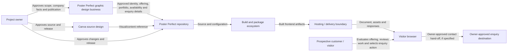

# L0 — System context and scope

**Canonical level:** L0 — Intent and context  
**Record class:** Target-state context map  
**Status:** Partially specified; source-design facts blocked pending inspection

## 1. System intent

Poster Perfect is the company portfolio website for a graphic design business. It represents the company at business level, not an individual designer's personal portfolio. Its business purpose is to present the company's owner-approved identity, positioning, capabilities and selected creative work, communicate availability for new projects, establish confidence, and attract prospective customers through an owner-approved enquiry path (DEC-008, PP-REQ-010).

The supplied Canva design is the visual/content reference for the web implementation. It does not replace the separately confirmed business purpose. The implementation direction is React with TypeScript/TSX and a maintainable, responsive component-based frontend. The intent is not to reproduce a static canvas as a single screenshot; meaningful content and approved interactions should use semantic web content and native browser behavior where appropriate.

## 2. Actors and external entities

| ID | Entity | Role | Trust / authority | Current status |
|---|---|---|---|---|
| `PP-MAP-001` | Project owner | Owns source design, scope decisions, approval and release authorization | Authoritative for project intent and approval | Confirmed |
| `PP-MAP-002` | Prospective customer and other website visitor | Evaluates the company's offering and approved work, then uses an available enquiry route where appropriate | Untrusted input source; user intent must be validated at relevant boundaries | Expected actor |
| `PP-MAP-003` | Browser runtime | Executes the frontend, layout, rendering and browser-native behavior | Execution environment; behavior varies by browser | Confirmed boundary |
| `PP-MAP-004` | Source design (Canva) | Visual and content reference for the recreation | Authoritative for owner-approved visual/content facts | Supplied; not yet inspectable |
| `PP-MAP-005` | Build and package ecosystem | Resolves dependencies and produces deployable frontend assets | External supply-chain boundary | Toolchain not selected |
| `PP-MAP-006` | Hosting/runtime delivery | Serves the built website to visitors | Operational boundary | Provider not selected |
| `PP-MAP-007` | External destinations or services | Potential contact destinations or other integrations invoked by page controls | External and not trusted by default | Unknown; not assumed |
| `PP-MAP-008` | Poster Perfect graphic design business | Business represented by the website; supplies owner-approved company identity, offering, portfolio material, availability and enquiry details | Business facts and publication permissions require owner approval; company size/legal structure are not inferred | Company-level purpose confirmed; detailed profile pending Phase 0 |

No additional external provider, CRM, submission service, or organization is part of the approved runtime scope unless separately authorized.

## 3. Context diagram

The diagram shows the intended delivery boundary, not a deployed topology. Build provider, host, route structure, API connectivity, and exact request paths remain undecided.

## 4. System boundary

### Inside the project boundary

- React application source and TSX components.
- TypeScript contracts and application composition.
- Design tokens and styling.
- Source-approved static assets.
- Page and interaction behavior explicitly included in the approved scope.
- Build configuration, package manifest, lockfile, and quality configuration.
- Documentation and verification evidence.

### Outside the project boundary unless approved

- Canva editor and account administration.
- Authentication and user-account services.
- Backend APIs and databases.
- Forms with remote submission.
- Analytics, tracking, advertising, and telemetry services.
- Payment processing or other transactions.
- CMS or content-authoring infrastructure.
- Hosting provider and CDN configuration.
- External APIs or integrations.

A visual affordance in the Canva source does not automatically authorize a new remote service or persistent data flow. Its intended behavior must be established.

## 5. Data and trust boundaries

No domain database or business-data model has been established. Current confirmed data classes are limited to:
- Source-design content and assets.
- Static website content and assets.
- User navigation and interaction input.
- Build-time dependency and configuration metadata.

Potential personal data, form data, analytics identifiers, credentials, or payment information are not in scope unless a future approved requirement introduces them. If introduced, the scope, lawful basis, data minimization, retention, security, and privacy obligations must be reviewed before implementation.

Treat external navigation destinations, any future API responses, imported assets, and dependency packages as external inputs. Validate and handle them at their appropriate boundary.

## 6. Explicit non-goals at baseline

- No backend is presumed.
- No database or browser persistence is presumed.
- No login, account, or authorization model is presumed.
- No payments, subscriptions, analytics, or third-party form provider is presumed.
- No specific customer segments, page count, route model, service categories, portfolio entries, client endorsements, contact channels, prices, company size, or team structure are inferred.
- No company credentials, client relationships, testimonials, awards, metrics, or project outcomes are fabricated.
- No specific router, styling library, UI component framework, build tool, package manager, or hosting provider is selected.
- No production deployment is claimed.

## 7. L0 exit conditions

L0 is sufficiently specified for implementation when:
- The company-level purpose is owner-confirmed: Poster Perfect is a graphic design company portfolio intended to attract prospective customers (DEC-008).
- Specific target customer segments, company positioning, service offering, publishable portfolio material and permissions, current availability wording, and enquiry route are confirmed or recorded as accepted limitations.
- In-scope pages/artboards and expected content are inventoried.
- Actors and external integrations are identified or explicitly excluded.
- System and trust boundaries are approved.
- Non-goals and unresolved questions are recorded.
- The owner has approved the web interpretation of the source design and the company-facing content/customer-enquiry journey.

Current L0 state: **blocked** by source inspection and the remaining company-content and enquiry-path decisions; the company-level website purpose is accepted.
