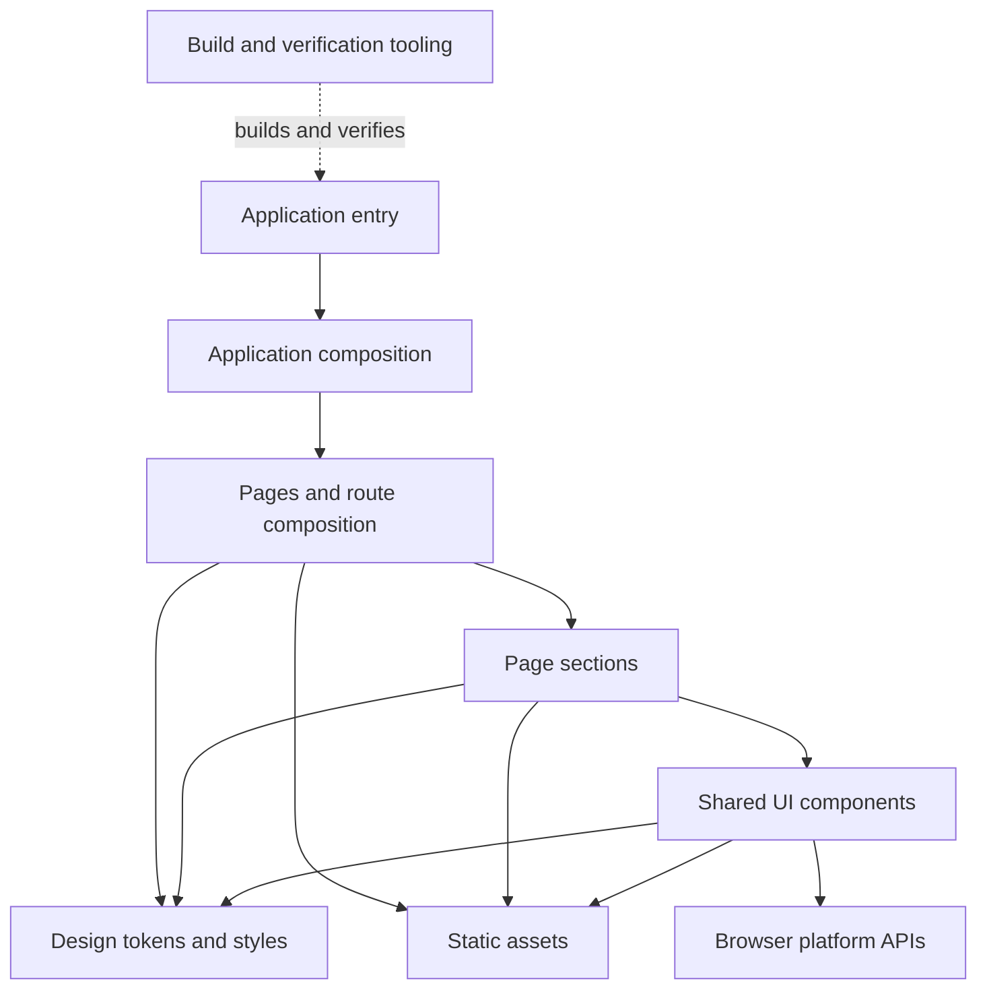

# L1 — Architecture map and ownership boundaries

**Canonical level:** L1 — Structure and ownership  
**Record class:** Target-state architecture map  
**Status:** Logical boundaries accepted; concrete module topology pending source and toolchain decisions

## 1. Architecture objective

Translate the L0 system boundary into a small, understandable React frontend. Architecture exists to preserve responsibility boundaries and design consistency, not to maximize the number of folders, packages, or abstractions.

The provisional default is a single frontend application with page composition, reusable components where justified, styling/design tokens, static assets, and a deliberately small set of runtime dependencies. Phase 0 must confirm the page and delivery requirements before this becomes a final topology decision. Separate applications, microfrontends, backend services, and distributed architecture are not assumed.

## 2. Logical component map

| ID | Boundary kind | Component boundary | Accountable owner role | Owns | Must not own |
|---|---|---|---|---|---|
| `PP-MAP-010` | Frontend runtime | Application composition | Application maintainer | App entry, global providers only when required, page composition root | Page-specific visual details unrelated to composition |
| `PP-MAP-011` | Frontend runtime | Page/route composition | Page implementation owner | Page selection and section composition order (order and page set specified in `information-architecture.md`); route mapping only if multiple routes are confirmed | Duplicate implementation of shared visual primitives; a router is not required for a single-page site |
| `PP-MAP-012` | Frontend runtime | Page sections | Section implementation owner | Coherent content regions derived from the approved design | Unrelated global configuration |
| `PP-MAP-013` | Frontend runtime | Shared UI components | Component maintainer | Repeated presentation or behavior with a typed interface (per-component contracts in `component-blueprint.md`) | Hidden page-specific business rules |
| `PP-MAP-014` | Frontend styling | Design tokens and styling | Frontend/design-system maintainer | Semantic colors, type roles, spacing, layout, responsive rules | Content ownership or network orchestration |
| `PP-MAP-015` | Frontend resources | Static assets | Asset maintainer / project owner | Approved image, icon, illustration and font assets | Unapproved third-party asset sourcing |
| `PP-MAP-016` | Frontend interaction | Interaction adapters | Interaction/component owner | Explicit browser interaction boundaries if the design requires them | Unreviewed persistence or remote side effects |
| `PP-MAP-017` | Engineering tooling | Build and verification tooling | Build/CI maintainer | Dependency resolution, compile, lint, tests, output generation | Runtime product behavior |
| `PP-MAP-018` | Cross-cutting governance (not a runtime component) | Documentation and ICM | Documentation/ICM maintainer | Requirements, architecture contracts, process/effect maps, verification records | Replacing source-design truth or implementation evidence |

These are logical boundaries, not a mandate to create one directory per row. PP-MAP-010–016 describe frontend runtime responsibilities, PP-MAP-017 describes engineering tooling, and PP-MAP-018 is a cross-cutting governance boundary rather than a runtime component. Physical modules should be created only when needed by the inspected page structure.

## 3. Dependency direction

The diagram expresses conceptual composition. Shared components do not need to be used by every page, and page sections may use CSS and assets directly where appropriate.

## 4. Dependency rules

1. Application composition may depend on pages and global configuration.
2. Pages may compose page sections and shared UI components.
3. Page sections may use shared components, design tokens, and approved assets.
4. Shared components may depend on design tokens and browser primitives behind explicit, typed interfaces.
5. Shared components MUST NOT import page implementations or depend on a particular route.
6. Design tokens MUST NOT depend on page content or component implementation.
7. Static assets MUST NOT contain hidden application behavior.
8. Build tooling MUST NOT become a runtime dependency unless the selected architecture requires it.
9. Avoid circular dependencies and re-export barrels that obscure ownership or create cycles.
10. Do not introduce a separate domain, state, service, or data layer unless actual requirements justify it.

## 5. Interface boundaries

| Boundary | Contract owner | Required contract |
|---|---|---|
| App → Page | Application composition | Route/entry, page selection, shared context |
| Page → Section | Page composition | Typed content/configuration inputs and composition order |
| Section → Component | Component consumer/owner | Props, events, semantics, responsive expectations |
| Component → Browser | Component/interaction owner | Trigger, browser capability, result and failure behavior |
| Page → External destination | Product owner | Exact destination, navigation behavior and security attributes |
| Application → Remote API | Not established | Must be defined only after an approved API requirement |
| Build → Deploy target | Toolchain/deployment owner | Build command, output, environment and promotion contract |

Every cross-boundary interaction must be visible in the contract inventory. Internal function calls with no independent contract need not receive artificial contract records.

## 6. Physical topology decision

Pending Phase 1:
- Build tool and source layout.
- Whether multiple pages require a router.
- Whether a styling convention requires dedicated directories.
- Asset loading strategy.
- Test organization.
- Hosting output contract.

Do not pre-create packages, feature modules, or infrastructure to fill this map.

## 7. Architecture invariants

- One application composition root.
- Component boundaries follow actual visual/behavioral cohesion.
- Typed props at component boundaries.
- No hidden network or persistent state inside presentational components.
- No external dependency without a documented purpose.
- Browser APIs are isolated to the interaction that needs them.
- Meaningful content remains accessible as document content.
- No page or route facts are invented before Phase 0.

## 8. L1 verification

Review each implemented module against its declared responsibility. Verify dependency direction through code review and, if the actual project structure justifies it, lightweight static or architecture tests. Do not add an architecture-testing dependency merely to prove a trivial tree.

L1 is complete when the physical application map matches the approved logical map, module ownership is clear, all material interfaces are recorded, and there are no unjustified cycles or responsibility violations.
